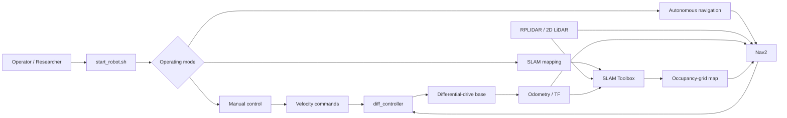
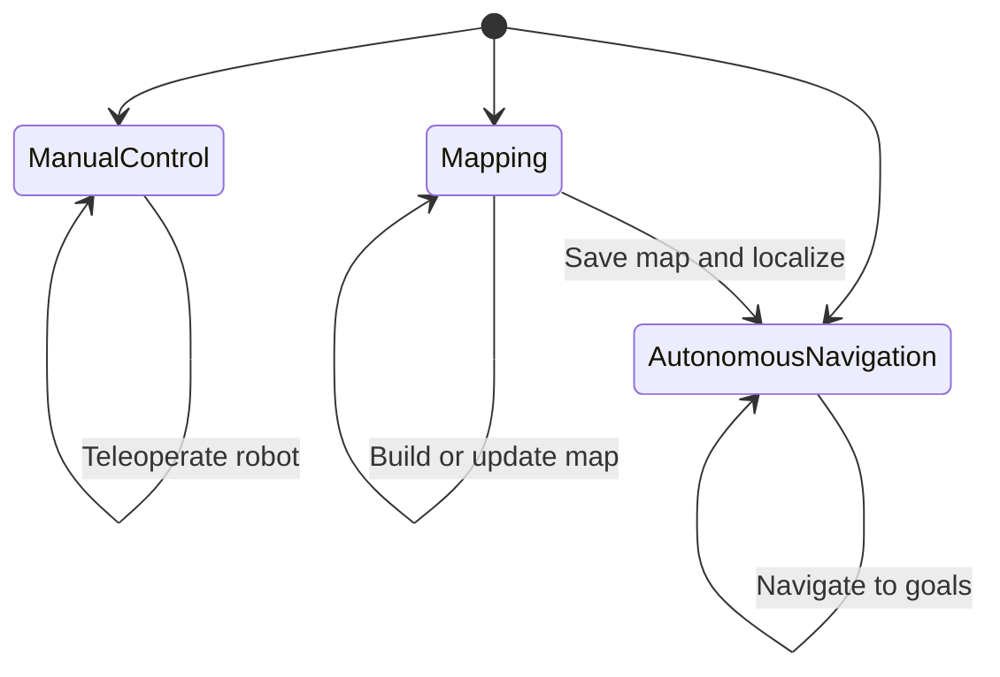

# Eagle Bot ROS 2 Workspace

ROS 2 workspace for a differential-drive mobile robot designed for indoor warehouse environments. The project integrates low-level motor control, 2D LiDAR sensing, SLAM, localization, and autonomous navigation using the ROS 2 ecosystem.

## Project goals

- Provide a reproducible software stack for an autonomous indoor mobile robot.
- Support manual teleoperation, map creation, localization, and autonomous navigation.
- Expose controller and navigation parameters for systematic tuning and experimentation.
- Provide a clear starting point for research, prototyping, and further laboratory development.

## System overview



## Main capabilities

- **ROS 2 integration:** Uses ROS 2 packages and launch files to organize the robot software stack.
- **Differential-drive control:** Includes a `ros2_control` hardware interface in `src/diff_controller`.
- **2D LiDAR sensing:** Integrates SLAMTEC LiDAR hardware through the included `sllidar_ros2` package.
- **Mapping and localization:** Provides configuration for creating maps and localizing within known environments.
- **Autonomous navigation:** Includes Nav2 configuration for path planning and goal-directed navigation.
- **Interactive startup:** `start_robot.sh` provides a single entry point for the main operating modes.
- **Parameter tuning:** Motor-control and navigation parameters are kept in YAML configuration files.

## Operating modes



| Mode | Purpose |
| --- | --- |
| Manual control | Drive the robot with keyboard-based teleoperation. |
| Mapping | Create a map of an unknown indoor environment using SLAM. |
| Autonomous navigation | Navigate through a known, pre-mapped environment. |

## Repository structure

```text
.
├── src/
│   ├── eagle_bot/
│   │   ├── config/          # Controller and Nav2 parameters
│   │   └── launch/          # ROS 2 launch files
│   ├── diff_controller/     # ros2_control hardware interface
│   └── sllidar_ros2/        # SLAMTEC LiDAR ROS 2 package
├── install_dependencies.sh  # Dependency installation helper
└── start_robot.sh           # Interactive startup script
```

## Requirements

- Ubuntu with a compatible ROS 2 installation
- ROS 2 Humble is the recommended distribution
- `colcon`
- `ros-humble-navigation2`
- `ros-humble-slam-toolbox`
- `ros-humble-ros2-control`
- `ros-humble-ros2-controllers`
- `gnome-terminal`
- Compatible differential-drive hardware
- SLAMTEC RPLIDAR or compatible 2D LiDAR

The current configuration targets ROS 2 Humble. Other ROS 2 distributions may require package or parameter changes.

## Installation and build

Clone the repository and install the system dependencies:

```bash
git clone https://github.com/Robin-Lange/green_robot.git
cd green_robot
./install_dependencies.sh
```

Build and source the workspace:

```bash
source /opt/ros/humble/setup.bash
colcon build --symlink-install
source install/setup.bash
```

### Hardware permissions

The LiDAR and motor controller may require udev rules so that the user can access their serial devices consistently. The exact rule depends on the hardware identifiers (`idVendor` and `idProduct`).

For an RPLIDAR, a rule may resemble:

```text
SUBSYSTEM=="tty", ATTRS{idVendor}=="2c42", MODE="0666", SYMLINK+="rplidar"
```

After adding or changing a rule, reload udev and reconnect the device:

```bash
sudo udevadm control --reload-rules
sudo udevadm trigger
```

Verify the device name and update the relevant ROS 2 parameters if necessary.

## Running the robot

From the repository root:

```bash
source /opt/ros/humble/setup.bash
source install/setup.bash
./start_robot.sh
```

The interactive menu launches one of the supported modes:

1. Manual control
2. Autonomous navigation
3. SLAM mapping

The robot must be connected and the required sensors must be available before launching hardware-dependent modes.

## Configuration and tuning

Important configuration files include:

- `src/eagle_bot/config/my_controllers.yaml` — differential-drive controller and wheel calibration parameters.
- `src/eagle_bot/config/nav2_params.yaml` — Nav2 planners, controllers, costmaps, and goal-checker parameters.
- `src/eagle_bot/launch/` — launch files for composing the robot software stack.

### Straight-line drift

If the robot consistently drifts while driving straight, tune the wheel-radius multipliers in `my_controllers.yaml` to compensate for differences between the motors or wheels:

```yaml
left_wheel_radius_multiplier: 1.0
right_wheel_radius_multiplier: 1.0
```

Make small changes and validate the result with repeatable straight-line tests.

### Navigation-goal oscillation

If the robot oscillates near a navigation goal, review the goal tolerances in `nav2_params.yaml`. Increasing `xy_goal_tolerance` or `yaw_goal_tolerance` can help when the robot reaches the practical accuracy limit of the platform. Any changes should be evaluated against the requirements of the intended experiment.

## Research use

This repository is intended as a practical robotics platform and a starting point for further research. Potential extensions include:

- Improved odometry and wheel calibration
- Sensor fusion and state estimation
- Robust navigation in dynamic warehouse environments
- Motion-planning and controller comparisons
- Multi-robot coordination
- Quantitative evaluation of mapping and navigation performance

## Acknowledgements

This project was developed under the supervision of **Timothy Sutton** ([@sutton-timothy85](https://github.com/sutton-timothy85)), who led the primary development of the repository and contributed substantially to the robot software and system integration.

## References

- [ROS 2 Humble documentation](https://docs.ros.org/en/humble/index.html)
- [Navigation2 documentation](https://navigation.ros.org/)
- [ros2_control documentation](https://control.ros.org/master/index.html)
- [SLAMTEC RPLIDAR ROS 2 package](https://github.com/Slamtec/sllidar_ros2)
- [teleop_twist_keyboard](https://index.ros.org/p/teleop_twist_keyboard/)
